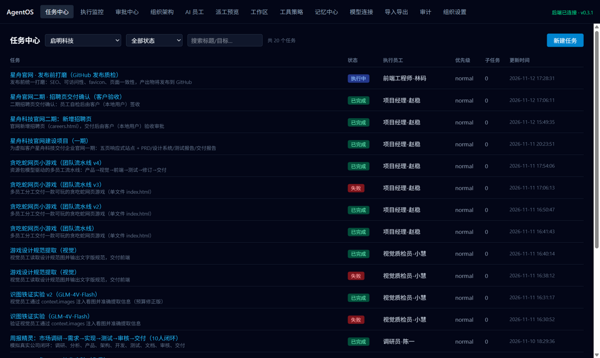
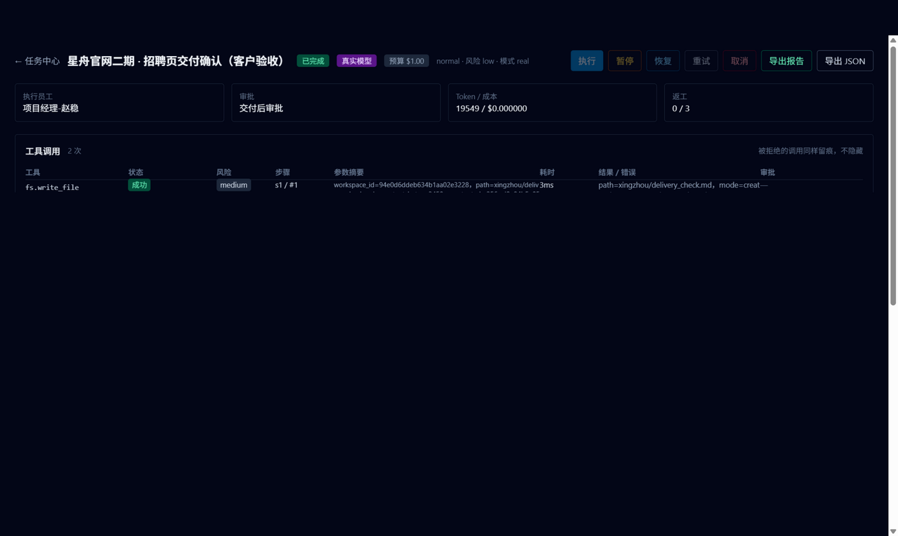
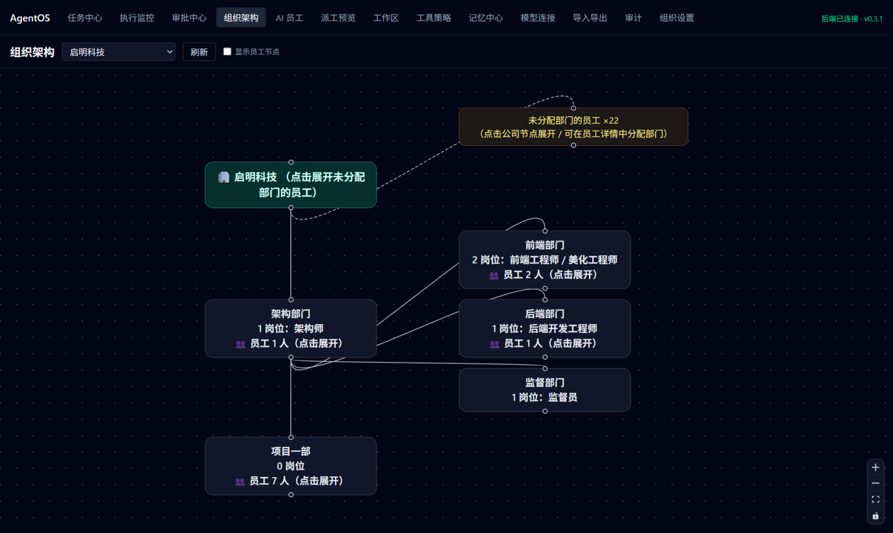
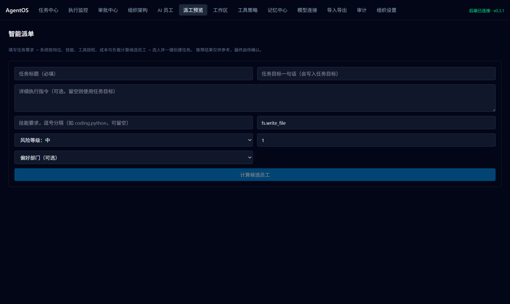
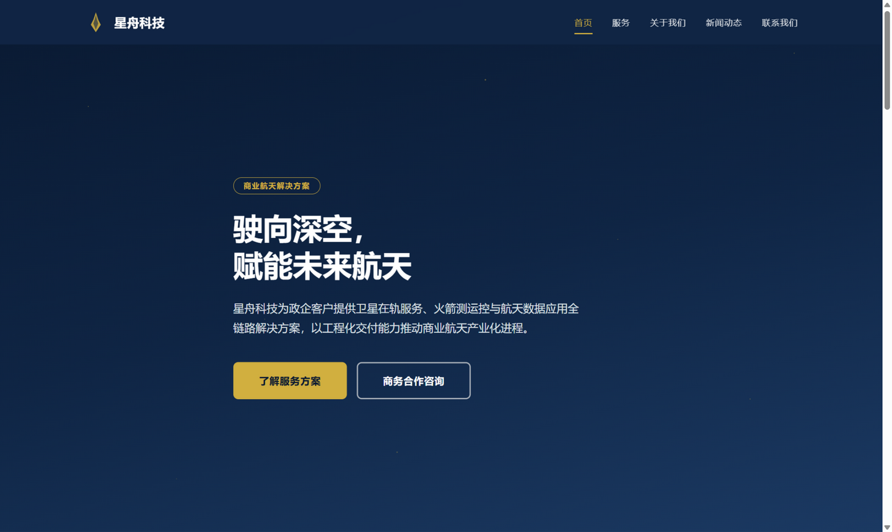
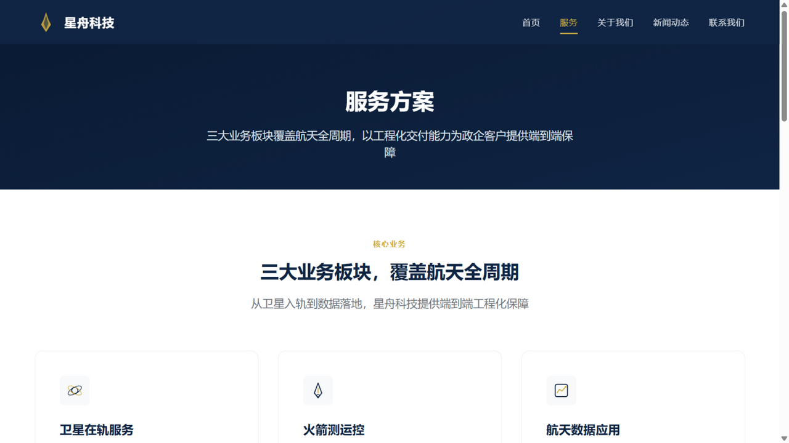
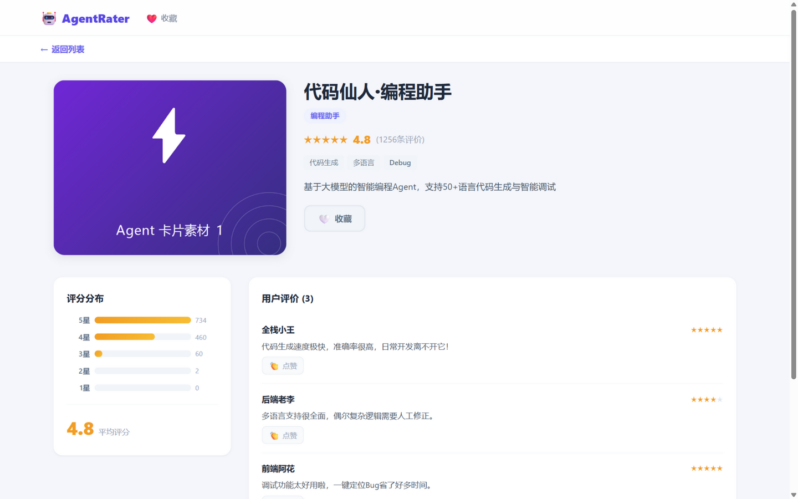
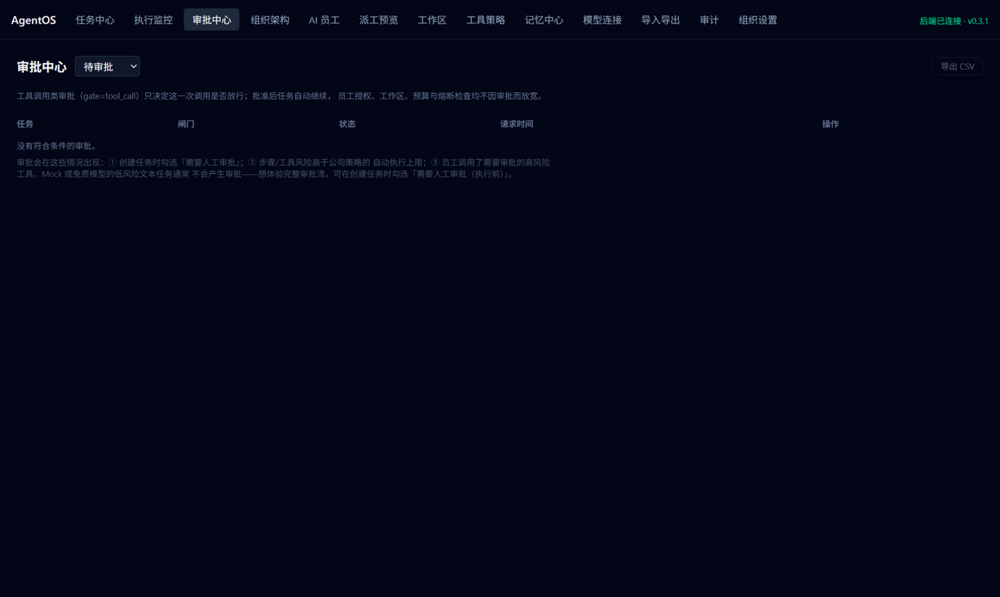
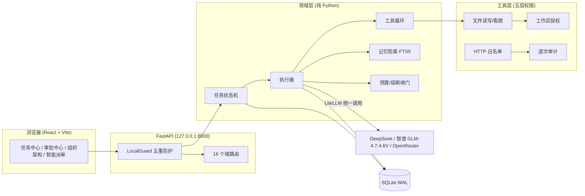

<div align="center">

# 🏢 AgentOS

**AI 数字员工协作操作系统 — 像经营一家真实公司一样，让 AI 团队为你交付成果**

[](#-质量与测试)
[](#-质量与测试)
[](requirements.txt)
[](https://fastapi.tiangolo.com)
[](apps/web)
[](LICENSE)
[](#-安全与治理)

**不是多 AI 聊天工具。** 每个 AI 员工有独立的身份、岗位、能力、权限和私有记忆；员工之间真实协作并互相验证；
交付物在审批卡片里**直接看到实际效果**；你始终拥有最终签收权。

*English one-liner: AgentOS is a locally-run "AI company" OS — org chart, job positions, permission layers,
task assignment, multi-agent execution with tool governance, and human sign-off gates.*

[快速开始](#-快速开始) · [系统一览](#-系统一览) · [真实交付案例](#-ai-团队真实交付案例) · [参与共创](#-参与共创)

</div>

---

## 📸 系统一览

| 任务中心与执行 | 审批 = 直接看网站实际效果 |
|---|---|
|  |  |

| 组织架构（零重叠，点击展开员工） | 智能派单（候选人评分 → 一键建任务） |
|---|---|
|  |  |

## 🤖 AI 团队真实交付案例

以下成果**全部由 AgentOS 里的 AI 员工完成**，人类只做任务定义与最终验收——这正是本项目的目标：给 AI 一家公司，而不是一个聊天框。

### 案例 1：为虚拟客户「星舟科技」交付企业官网 🌐

7 名跨职能 AI 员工（调研/产品/UI 设计/文案/前端/测试/项目经理）通过 **9 步瀑布流水线**完成，全程 11 次人工审批、15 个执行 run、74.7 万 tokens：

```
市场调研 → PRD → 🖼 UI 设计师看品牌图提取规范 ┐
                                            ├→ 前端开发 → 测试(11 缺陷) → 修复 → 交付报告
                                文案撰写 ────┘
```

| 交付物 | 验收方式 |
|---|---|
| 五页响应式官网 + 共享 CSS/JS（16.8KB 首页） | 真浏览器逐页验收：导航高亮、表单校验、移动端 375px 适配 |
| PRD / 设计系统 / 测试报告 / 交付报告 | 项目经理签发，10/10 验收标准通过 |




### 案例 2：AgentRater · AI 智能体点评平台（魔改版点评系统）⭐

借鉴经典点评类项目的技术内核（评分聚合/分类榜单/互动），**业务对象魔改为 AI 智能体应用**：6 步流水线（PRD → 数据工程 → 首页 → 详情页 → 测试 → 交付）交付多页可交互站点——20 个虚构 AI Agent、搜索/分类筛选/评分排序/评分分布图/评价点赞/收藏，图片素材由系统自动生成。32 万 tokens，真浏览器验收通过。




### 案例 3：AI 文档团队交付 10 章中文用户手册 📖

产品经理设计大纲 → 内容文案撰写前三章 → 文档工程师撰写进阶章节 → 产品经理汇编审阅，**43KB 手册**直接进入 `docs/user-guide.md` 随仓库发布。命令示例经逐条核对，功能描述与源材料严格一致（禁止编造）。同一套流水线也完成了官网的发布前打磨（SEO / OG 标签 / favicon / 无障碍审计）。

### 案例 4：客户签收闭环 ✅

交付后（`after_run`）审批闸门 + 审批卡片内嵌**网站实际渲染**——签收人看着成果批，而不是读文档猜：

| 审批中心 | 交付签收（内嵌成果预览） |
|---|---|
|  |  |

## ✨ 核心特性

- 🏢 **AI 公司组织** — 公司/部门/岗位/上下级，组织架构图点击展开员工；员工与模型解耦（主备模型）
- 🔌 **多模型接入** — LiteLLM 统一调用（DeepSeek / 智谱 / OpenRouter 实测）；凭据只存 `env:` 引用不入库；供应商 max_tokens 超限自动降级自愈
- 📋 **任务中心** — 状态机、计划与递归子任务、失败重规划、断点续跑、预算预扣
- ⚙️ **执行引擎** — 后台队列真实执行；暂停/恢复/取消；重启恢复检查点
- 🤝 **多 Agent 协作** — 依赖 DAG、拓扑波次并行、上下文交接、失败不伪造
- 🧰 **工具执行层** — 工作区授权、文件/HTTP 工具、**视觉工具（AI 看图）**、五层权限、敏感文件防护、逐次审计
- 🖼️ **多模态** — 步骤级图片注入 + 图片工具双路径；GLM-4V/4.6V 实测"看图提取设计规范"驱动前端实现
- ✅ **人工审批** — 执行前/交付后双关卡 + 工具调用逐次审批；交付签收卡片内嵌成果预览
- 🧠 **长期记忆** — 三级作用域（员工私有/项目/公司）、FTS5 中文 2-gram 检索、自动注入执行上下文
- 👥 **多 Worker** — 租约/心跳/原子认领/崩溃恢复
- 💰 **可观测** — 时间线（全中文）、Token/成本聚合、监控摘要、Mock 明确不计费
- 🏠 **本地优先** — 默认只监听 127.0.0.1；Shell 永久禁用；工具全局开关默认关闭

## 🏗️ 架构



## 🚀 快速开始

```bash
# 1) 后端
python -m venv .venv
.venv\Scripts\activate              # Windows
pip install -r requirements.txt
pip install -e .
copy .env.example .env              # 填入 DEEPSEEK_API_KEY（真实模式用；Mock 模式无需任何 Key）
alembic upgrade head
python scripts/run_api.py --port 8000   # 只监听 127.0.0.1

# 2) 前端（另开终端）
cd apps/web && npm install && npm run dev   # http://127.0.0.1:5173

# 3) 建公司 → 建 AI 员工 → 绑模型 → 派第一个任务 🎉
```

> **零成本体验**：不填任何 API Key 也能完整运行（Mock 模式），全部测试与端到端验收免费。
> **执行模式**：`mock` 不调外部服务；`real` 使用员工绑定的模型连接并真实计费。
>
> 📖 **完整使用说明**：[docs/user-guide.md](docs/user-guide.md)——10 章中文手册（由 AI 文档团队编写），覆盖建公司、派任务、审批与安全、记忆、FAQ。

## 🧪 质量与测试

| 维度 | 状态 |
|---|---|
| 单元/集成测试 | **392 passed, 3 skipped**（全 Mock，免费） |
| 真浏览器验收 | **32/32**（本机 Edge + CDP，不安装 Playwright） |
| 静态检查 | ruff 全绿 |
| 端到端 | M2 13 项 · M3-F 16 项（GitHub 教程场景） |
| 密钥安全 | 全历史扫描零真实密钥；`.env`/`data/`/`tmp/` 隔离 |

```bash
.venv\Scripts\python.exe -m pytest tests\ -q
.venv\Scripts\python.exe scripts\browser_acceptance.py
```

## 🔐 安全与治理

五层工具权限，逐层收窄、缺一不可：

```
1 全局开关(默认关) → 2 公司策略(类别/白名单/风险上限) → 3 员工白名单
→ 4 岗位权限画像 → 5 工作区读写授权
```

- 路径安全：拒绝绝对路径/盘符/`..`/symlink 逃逸，敏感文件（.env/密钥/ssh）直接拒绝
- HTTP：域名白名单 + DNS 逐 IP 校验（SSRF 防护）+ 逐跳重定向检查
- 审计：全量脱敏留痕；预算熔断 / 连续拒绝熔断 / 全局 Kill Switch
- Shell：**无命令执行代码路径**（AST 扫描证明），永久禁用

## 🗺️ 路线图

| 里程碑 | 内容 | 状态 |
|---|---|---|
| M0-M2 | 基座 / 组织 / 任务闭环 / 多 Agent / 审批 | ✅ |
| M3 | 工具执行层 / 监管闸门 / 递归任务 / 长期记忆 / 多 Worker / 端到端 | ✅ |
| M3.5 | 多模态识图 / 智能派单 / 交付物预览 / 供应商自愈 | ✅ |
| **M4** | 账号体系（注册/登录/多用户数据隔离/认证开关）· 轻量 RAG（TF-IDF 中文融合检索）· 一键生产部署 · 大型点评平台实验 | ✅ |

## 🤝 参与共创

这个项目的野心是**让每个人都能拥有并经营自己的 AI 公司**——一个人跑不完，诚邀共建：

- 🐛 **修 Bug / 提体验**：`good first issue` 包括 UI 中文化补全、错误提示优化、组织图交互增强
- 🧪 **复杂实验**：拿你的真实业务场景跑一条流水线，把暴露的问题变成 issue（本项目每个功能都源自实验）
- 🧩 **新工具**：在五层权限框架内扩展工具族（数据库查询/表格处理/图表生成…），参考 [CONTRIBUTING.md](CONTRIBUTING.md)
- 📖 **文档**：用户手册、教程、英文翻译

> 贡献前请阅读 [CONTRIBUTING.md](CONTRIBUTING.md)（五分钟）——三条铁律：**每个功能配测试、不用假数据冒充真实功能、安全红线不可违背**。

## 📄 License

[MIT](LICENSE) — 放心使用、修改、二次分发。

<div align="center">

**如果这个项目对你有启发，欢迎点一个 ⭐**

[快速开始](#-快速开始) · [真实交付案例](#-ai-团队真实交付案例) · [参与共创](#-参与共创)

</div>
